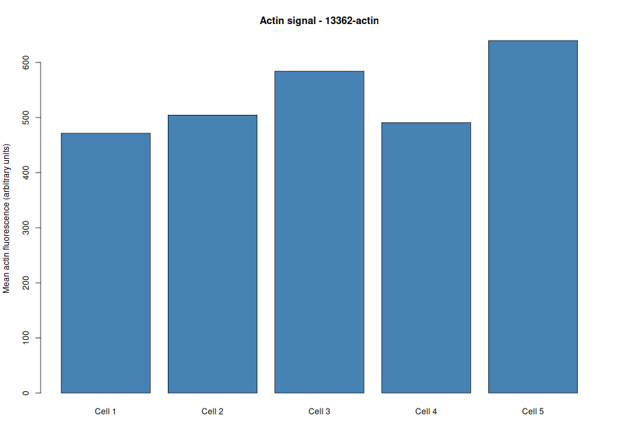
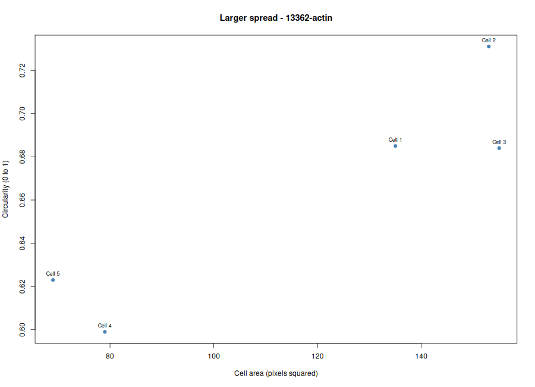

# BBBC018 · Cytoskeleton and Cell Morphology Lab
- **Student ID:** `BBBC018_largespread_1336
- **Course Context:** Karp, Chapter 9 — The Cytoskeleton and Cell Motilit
- **Tools Used:** Fiji/ImageJ, R, Posit Cloud, GitHu
- **Dataset:** Broad Bioimage Benchmark Collection (BBBC018) — HT29 Human Colon Cancer Cell

## 1. Image Selection and Registrati

I reviewed the 14 morphological phenotype categories in the BBBC018 dataset and selected the **Large spread** phenotype. I chose image field **13362** after comparing its cellular morphology with the dataset's reference images. I registered the field in the class spreadsheet and verified that it had not been selected by another student

**Selected files:**
- `13362-actin.DIB` — F-actin channel
- `13362-DNA.DIB` — DNA channel

## 2. Image Import and Preparation in Fiji

I imported both image channels into Fiji to examine the F-actin cytoskeleton and nuclear staining. After inspecting the field, I selected five intact, distinguishable cells that did not overlap or touch the image borders for morphological measurement.

## 3. Morphological Measurements in Fiji

I configured Fiji to measure area, mean gray value, shape descriptors, and ROI labels. Using the Freehand Selection tool, I traced the boundaries of five cells in the actin channel, referring to the DNA channel when needed. I saved the ROIs in the ROI Manager and measured each selected cell.

The measurements include
- **Area:** The size of the traced cell region in pixels
- **Mean Gray Value:** The average fluorescence intensity within the selected region, expressed in arbitrary image units
- **Circularity:** A measure of cell roundness, ranging from 0 to 1, with values closer to 1 indicating a more circular shape
- **Aspect Ratio:** The ratio of the major axis to the minor axis, with higher values indicating greater elongation

I exported the measurements to `data/fiji_results.csv` and saved an annotated image of the five selected cells as `figures/measured_cells.png

## 4. Data Analysis in R
I organized the project into `data/`, `scripts/`, `results/`, and `figures/`. I saved the Fiji measurements in `data/fiji_results.csv` and prepared `scripts/analyze_cells.R` for analysis in R through Posit Cloud
I configured the script with the selected phenotype (`Large spread`) and image field ID (`13362`). I then ran the analysis to generate summary statistics and visualization plots, organizing the outputs in the appropriate project folder.

## 5. Results and Visualization

### 5.1. F-Actin Intensity

**Figure 1. Mean F-actin fluorescence intensity of the selected cells.**

This plot presents the mean fluorescence intensity measured within each selected cell. The values describe the relative F-actin staining intensity in the analyzed regions. However, differences in fluorescence intensity should be interpreted cautiously because they may also be influenced by staining and imaging conditions.

### 5.2. Cell Area and Circularity

**Figure 2. Relationship between cell area and circularity.**

This plot compares the measured area and circularity of the selected cells. It helps visualize whether larger cells tend to have different shapes or degrees of roundness within the sampled field. Any apparent relationship should be interpreted cautiously because only five cells from one image field were measured.

## My answers to the questions
### Q1. What phenotype did you choose, and what image field ID did you registeer?
I selected the **Large spread** phenotype and registered image field **13362**, using `13362-actin.DIB` as the primary image.
### Q2. Why did you choose this field, and how does the actin staining compare with the reference phenotype?
I chose field 13362 because the cells appeared flattened, with broadly extended F-actin structures consistent with the Large spread reference phenotype.
### Q3. Why is it important not to compare raw mean fluorescence intensity directly across different image field?
Raw fluorescence intensity can vary with exposure settings, detector gain, illumination, and staining conditions. Therefore, intensity differences may reflect technical variation rather than actual differences in protein abundance.
### Q4. What do the morphological measurements tell you about the selected cell?
Area, circularity, and aspect ratio describe cell size and shape, while mean gray value measures average fluorescence intensity. Together, these parameters help characterize the morphology and F-actin staining of the selected cell.
