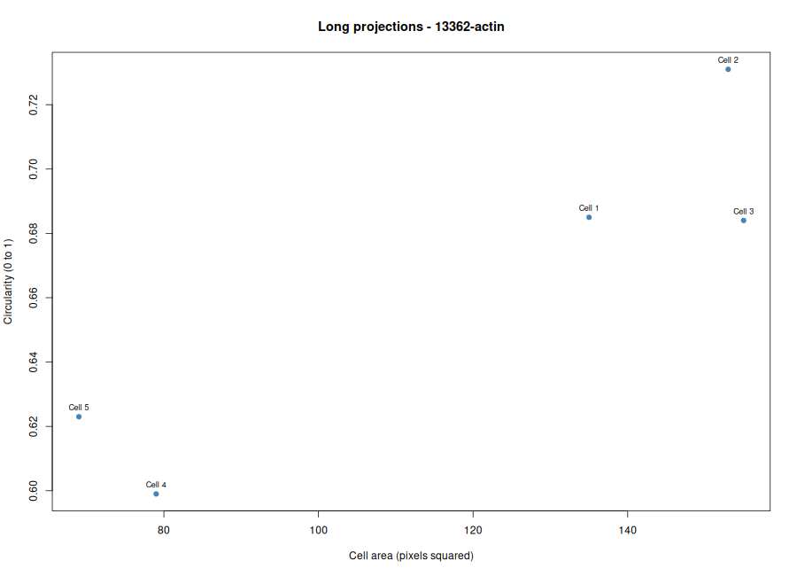

# BBBC018 · Cytoskeleton and Cell Morphology Lab
- **Student ID:** `BBBC018_largespread_13362
- **Course Context:** Karp, Chapter 9 — The Cytoskeleton and Cell Motility
- **Tools Used:** Fiji/ImageJ, R, Posit Cloud, GitHub
- **Dataset:** Broad Bioimage Benchmark Collection (BBBC018) — HT29 Human Colon Cancer Cell

## 1. Image Selection and Registrati

I reviewed the 14 morphological phenotype categories in the BBBC018 dataset and selected the **Large spread** phenotype. I chose image field **13362** after comparing its cellular morphology with the dataset's reference images. I registered the field in the class spreadsheet and verified that it had not been selected by another student

**Selected files:**
- `13362-actin.DIB` — F-actin channel
- `13362-DNA.DIB` — DNA channel

## 2. Image Import and Preparation in Fiji

I imported both image channels into Fiji to examine the F-actin cytoskeleton and nuclear staining. After inspecting the field, I selected five intact, distinguishable cells that did not overlap or touch the image borders for morphological measurement.

## 3. Morphological Measurements in Fiji

I configured Fiji to measure area, mean gray value, shape descriptors, and ROI labels. Using the Freehand Selection tool, I traced the boundaries of five cells in the actin channel, referring to the DNA channel when needed. I saved the ROIs in the ROI Manager and measured each selected cell.

The measurements include
- **Area:** The size of the traced cell region in pixels
- **Mean Gray Value:** The average fluorescence intensity within the selected region, expressed in arbitrary image units
- **Circularity:** A measure of cell roundness, ranging from 0 to 1, with values closer to 1 indicating a more circular shape
- **Aspect Ratio:** The ratio of the major axis to the minor axis, with higher values indicating greater elongation

I exported the measurements to `data/fiji_results.csv` and saved an annotated image of the five selected cells as `figures/measured_cells.png

## 4. Data Analysis in R
I organized the project into `data/`, `scripts/`, `results/`, and `figures/`. I saved the Fiji measurements in `data/fiji_results.csv` and prepared `scripts/analyze_cells.R` for analysis in R through Posit Cloud
I configured the script with the selected phenotype (`Large spread`) and image field ID (`13362`). I then ran the analysis to generate summary statistics and visualization plots, organizing the outputs in the appropriate project folder.

## 5. Results and Visualization

### 5.1. F-Actin Intensity
**Interpretation Note and Limitations:** The following plots present the measurements obtained from five selected cells in image field 13362. They are intended to describe the measured characteristics of these cells rather than establish general conclusions about the Large spread phenotype. This analysis is also limited to a single image field and a small sample of cells. In addition, fluorescence intensity may be affected by staining and image acquisition conditions, while cell boundary selection may introduce measurement variability. 

**Figure 1. Mean F-actin fluorescence intensity of the selected cells.**

This plot presents the mean fluorescence intensity measured within each selected cell. The values describe the relative F-actin staining intensity in the analyzed regions. 

### 5.2. Cell Area and Circularity

**Figure 2. Relationship between cell area and circularity.**

This plot shows the measured area and circularity of the five selected cells, allowing their size and shape characteristics to be compared visually.

## 6. Explanation of Results

### 1. Which specific phenotype did you choose, and what visible features support that choice?

I selected the **Large spread** phenotype because the cells displayed flattened, broadly extended cytoplasmic regions with prominent F-actin structures. These visible features were consistent with the reference images for this phenotype.

### 2. Were your five cells mostly round or elongated? Refer to your circularity and aspect-ratio results.

Since I have higher circularity values my five chosen cells are mostly round.

### 3. What role does actin play in maintaining cell shape and in cell movement (Karp Chapter 9)?

Actin filaments help maintain cell shape by providing structural support beneath the plasma membrane and organizing the cell cortex. Actin polymerization and interactions with myosin also contribute to cell movement by generating forces that support membrane protrusion and cellular contraction.

### 4. Why can a single fixed fluorescence image NOT show how fast a cell moves?

A single fixed fluorescence image captures the cell's structure at one point in time and does not show changes in its position over time. Measuring cell movement requires time-lapse imaging or sequential observations to track displacement over a known time interval and calculate movement speed.

### Data Credit & License Attribution
Used image set BBBC018v1 from the Broad Bioimage Benchmark Collection (Ljosa et al., Nature Methods, 2012).” The images are licensed CC BY-NC-SA 3.0; retain attribution when sharing image-derived screenshots.
